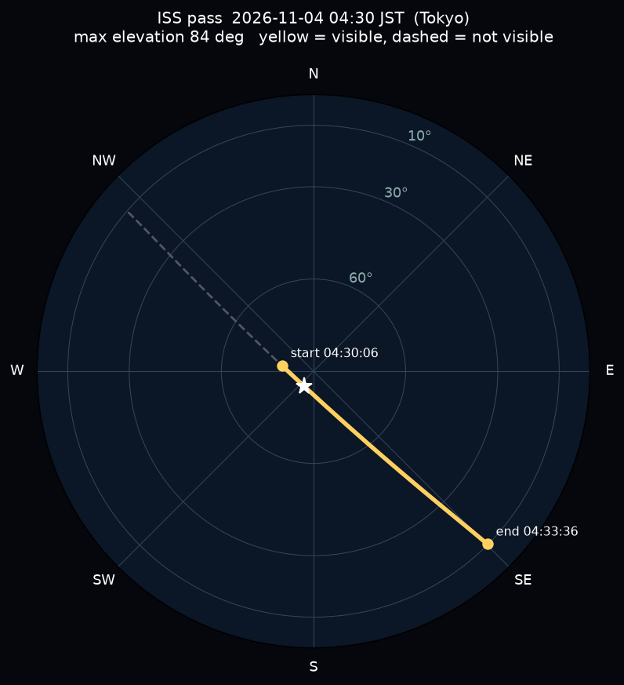
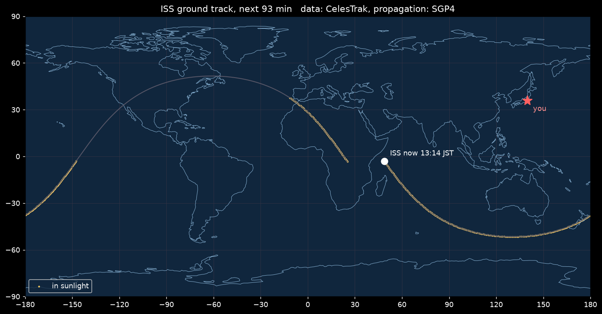

# iss-pass

国際宇宙ステーション(ISS)が自分の上空を通る時刻を予測し、そのうち肉眼で見える回を当てる Python スクリプトです。



空の図は真上を中心に、外周が地平線、上が北です。黄色の実線が肉眼で見える部分、破線が見えない部分です。

## 特徴

- 1ファイル・依存は [sgp4](https://pypi.org/project/sgp4/) / numpy / matplotlib
- 軌道データは [CelesTrak](https://celestrak.org/) から ISS(カタログ番号 25544)の TLE を取得し、ローカルにキャッシュ
- 「上空を通る」だけでなく「肉眼で見える」かを判定する
- 空の途中で地球の影に入って消える回を見分ける
- 次に見える回の空の図と、これから1周分の地上軌跡を PNG で出す

## 必要なもの

- Python 3.10 以上

```sh
python -m venv .venv
. .venv/bin/activate        # Windows は .venv\Scripts\activate
pip install -r requirements.txt
```

## 使い方

```sh
python iss_pass.py                                        # 東京駅で5日先まで
python iss_pass.py --days 10                              # 10日先まで
python iss_pass.py --lat 35.44 --lon 139.64 --place Yokohama   # 地点を変える
python iss_pass.py --all                                  # 見えない回も一覧に出す
```

実行すると、端末にこのような一覧が出ます(2026-11-03 に東京で実行した例)。

```
上空を通る回: 43 回 / うち肉眼で見える回: 10 回

★見える  11/04(水) 04:30:06 西の空から  →  最高 84度 南南西  →  04:33:36 南東へ沈む  (3分30秒)
★見える  11/05(木) 03:45:06 東南東の空から  →  最高 16度 東南東  →  03:45:56 東南東へ沈む  (0分50秒)
★見える  11/10(火) 17:59:06 南南西の空から  →  最高 45度 南東  →  18:02:26 東南東で影に入って消える  (3分20秒)
...
```

時刻は日本時間です。「最高」は見えている間で一番高い位置で、90度が真上です。

### オプション

| オプション | 既定値 | 説明 |
| --- | --- | --- |
| `--lat` / `--lon` | `35.6812` / `139.7671` | 観測地点の緯度・経度(度)。既定は東京駅 |
| `--height H` | `0` | 観測地点の標高(m) |
| `--place NAME` | `Tokyo` | 図のタイトルに入れる地名(英字) |
| `--days D` | `5` | 今から何日先まで探すか |
| `--all` | | 見えない回(昼間・地球の影の中)も一覧に出す |
| `--track-min M` | `93` | 地上軌跡を描く長さ(分)。ISS は約93分で地球を1周する |
| `--refresh` | | キャッシュを無視して TLE を取り直す |

### 出力ファイル

| ファイル | 内容 |
| --- | --- |
| `iss_next_pass.png` | 次に見える回の、空のどこを通るかの図。見える回がなければ出ない |
| `iss_ground_track.png` | 今からの地上軌跡(ISS の真下の点の移動)。黄色は ISS に太陽が当たっている区間 |



## 「見える」の条件

ISS は自分では光らず、太陽の光を反射して光ります。そのため、上空にいても見えない回がたくさんあります。このスクリプトは、次の3つを全部満たす時間を「見える」とします。

1. **ISS が地平線から10度以上の高さにいる。** これより低いと建物や山に隠れやすい
2. **観測地点の空が暗い。** 太陽が地平線の6度以上下にある、つまり日の入り後や日の出前
3. **ISS 自身には太陽の光が当たっている。** 地球の影に入っていない

2 と 3 を同時に満たすのは、地上は暗いが上空400 km にはまだ日が当たっている時間帯です。そのため ISS が見えるのは、日の入り後と日の出前の1〜2時間に限られます。夕方の回では空の途中でふっと消えることがあり、これは ISS が地球の影に入った瞬間です。

## しくみ

1. CelesTrak から ISS の TLE(2行軌道要素)を取得し `iss.tle` に保存
2. 今から指定日数ぶん、10秒刻みで ISS の位置(TEME 慣性座標、km)を sgp4 で一括計算
3. グリニッジ平均恒星時ぶん回して地球固定座標(ECEF)へ変換
4. 観測地点から見た「東・北・上」の座標に直し、高度角と方位を求める
5. 太陽の方向を簡易式で計算し、観測地点の空の暗さと、ISS が地球の影(円柱で近似)に入っているかを判定
6. 高度10度以上の連続した区間を1回の通過としてまとめ、見える区間を切り出す

## 注意

- 予測の精度は数十秒〜1分程度です。見上げる目安としては十分ですが、正確な予報は [JAXA「#きぼうを見よう」](https://lookup.kibo.space/) や [Heavens-Above](https://www.heavens-above.com/) と見比べてください。
- ISS はときどき噴射で軌道を持ち上げます。古い TLE だと予測がずれるため、6時間ごとに取り直します。
- 明るさ(等級)は予測しません。
- 地球の影は円柱で近似しています。影の境目の時刻は数秒ずれることがあります。

## 次にやりたいこと

- 見える回をカレンダー(ics ファイル)に書き出して、スマホに通知させる
- ISS 以外の明るい衛星や、中国の宇宙ステーション(天宮)にも対応する
- [starlink-orbits](https://github.com/MaruCat000/starlink) と組み合わせて、打ち上げ直後の Starlink の「列車」が見える回を探す

## 出典

- 軌道データ: [CelesTrak](https://celestrak.org/)(NORAD 25544)。軌道計算は [sgp4](https://pypi.org/project/sgp4/)
- 海岸線: [Natural Earth](https://www.naturalearthdata.com/) 1:110m Coastline
